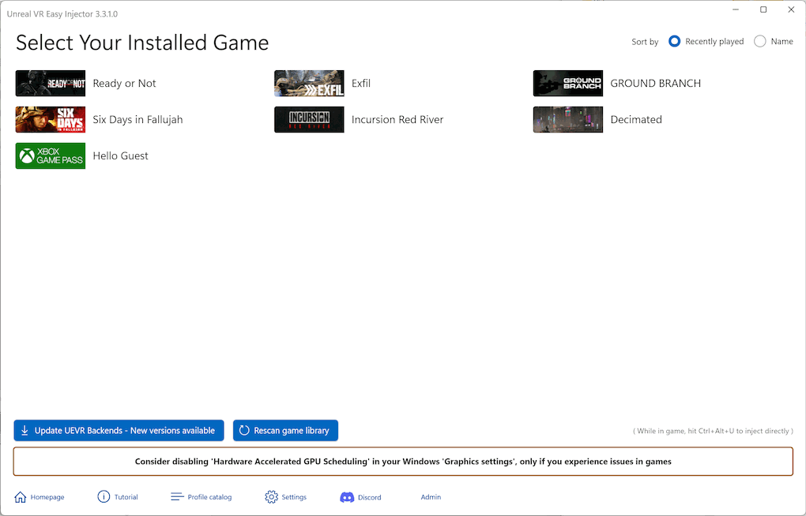
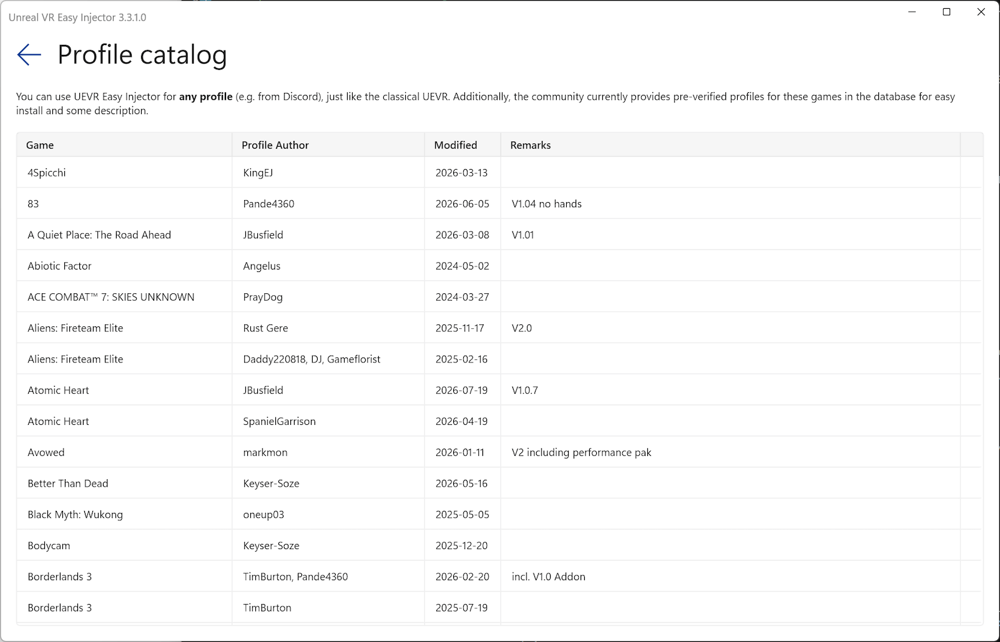
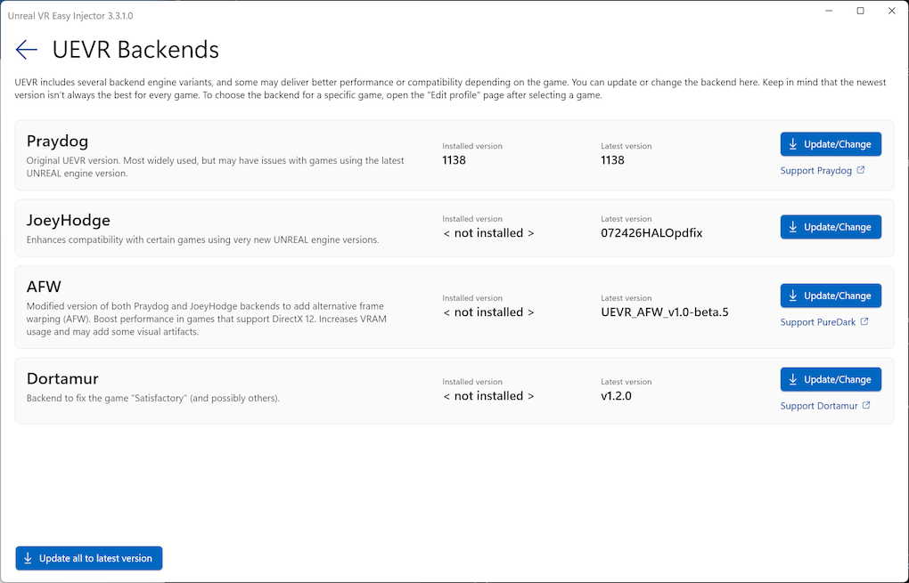
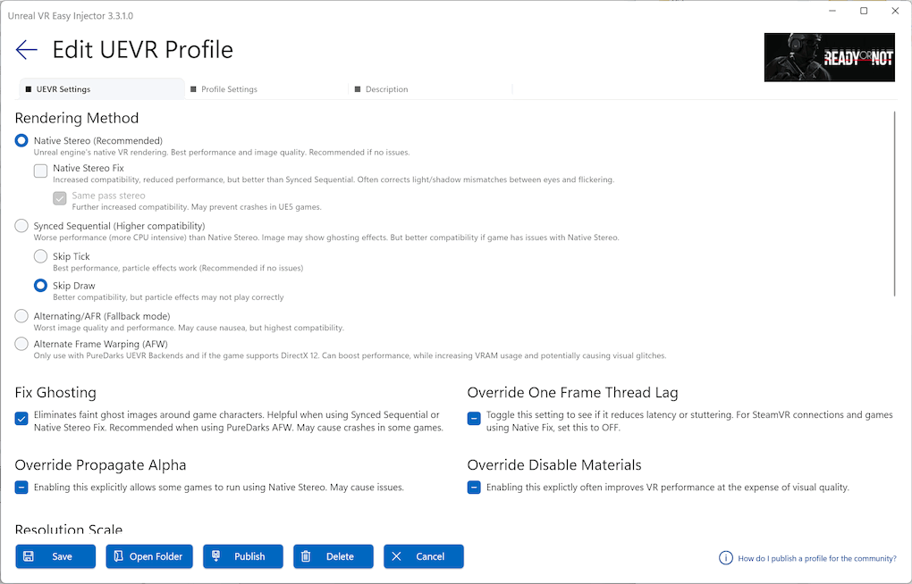
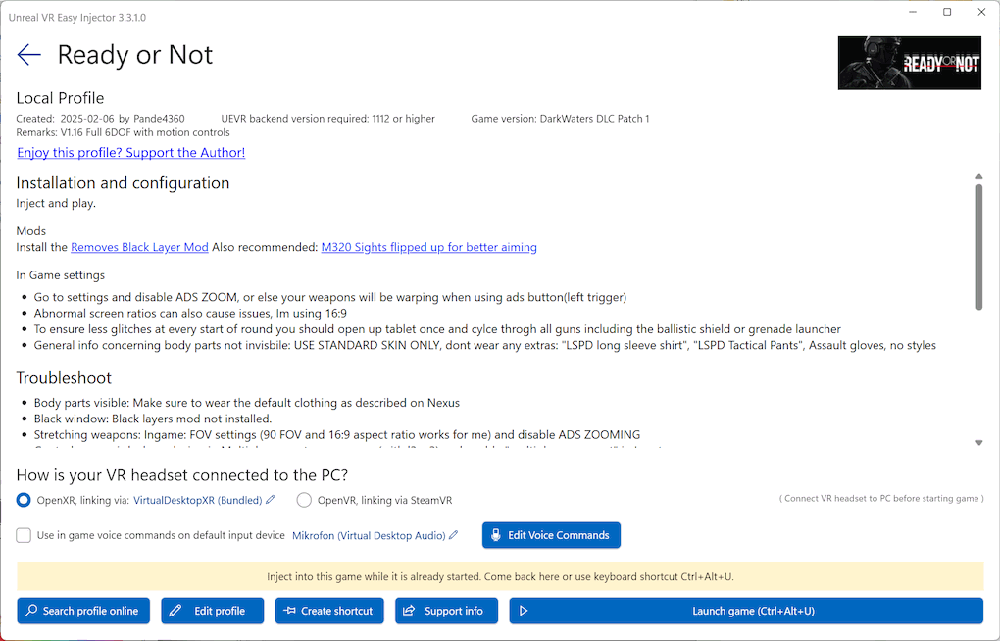
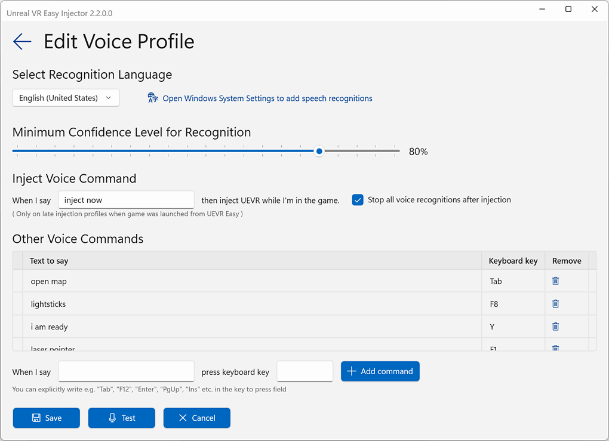

Play numerous Unreal Engine games in virtual reality, including with Meta Quest headsets.
This app uses [Praydog's brilliant UEVR module](https://github.com/praydog/UEVR), but replaces its interface with a new, user-friendly interface.
It adds features not found in UEVR classic, like:
- an online profiles database
- a selection of alternative backends (for example, JoeyHodge and PurDark/AFW, Dortamur), offering better compatibility and higher performance than UEVR Classic
- automatic updates for UEVR backends
- voice commands
- a user-friendly profile editor

UEVR for the casual user: mass-market compatible :smiley:

<a href="https://github.com/oduis/UEVRDeluxe/releases" class="download-link">Download latest release</a>

New to UEVR? Read [this step-by-step beginner tutorial](UEVRTutorial.md).

## Integration with Steam, Epic, Xbox, EA Games, and GOG
Guides you through the process, filters installed games that may use Unreal Engine, and warns you about common issues beginners face.
Update to the latest UEVR nightly backend version with one click.

## Online Profile Database
Contains many tested profiles from Discord and other sources and is constantly updated. Installation takes one click.

## Multiple UEVR Backends
Update and switch between backends easily on a per-game basis.

## Easy Profile Editor
Includes commonly used options with descriptions to help you get started:

It also contains helpful options that are not found in UEVR Classic's interface.

## Easily find a profile and start the game, including the XR runtime switcher
The new UEVR profile database includes documentation for each profile. No more searching Discord or outdated profile websites
(but you can still use them with UEVR Easy Injector, just like you would use them with UEVR Classic). 
Inject via a hotkey while running your game, without needing to tab around while wearing your headset.

## In-game Voice Commands
Configure easy-to-use voice commands per game. The RAM/CPU overhead is minimal:

(Do NOT run the app as administrator for voice commands.)

## Frequently Asked Questions
### Does it cost anything?
No, this is free for non-commercial use. However, you are encouraged to support UEVR's author here: [Praydog's Patreon](https://patreon.com/praydog).
### Do I need UEVR Injector Classic installed?
No, it is not necessary. However, it does no harm to have both installed, as long as you do not use both with the same games.
### Can I use game profiles not in the database (e.g. installed manually from Discord)?
Sure, just like with UEVR Classic.
### My Steam game is installed and based on Unreal Engine, but not showing up
Shut down and restart Steam, then rescan in UEVR Easy Injector. Alternatively, reboot, start Steam, and then start UEVR Easy Injector.
### I have a great profile. How to add it to the UEVR Easy Injector database?
Follow [this guide](SubmitProfile.md).
### What UEVR version is it based on? Can I use another?
Currently, it uses the current stable-looking nightly version when published. You can click the Update button to automatically download the latest or older nightly builds. Start UEVR Easy as administrator for this to work.
JoeHodge and PureDark UEVR versions are also supported.